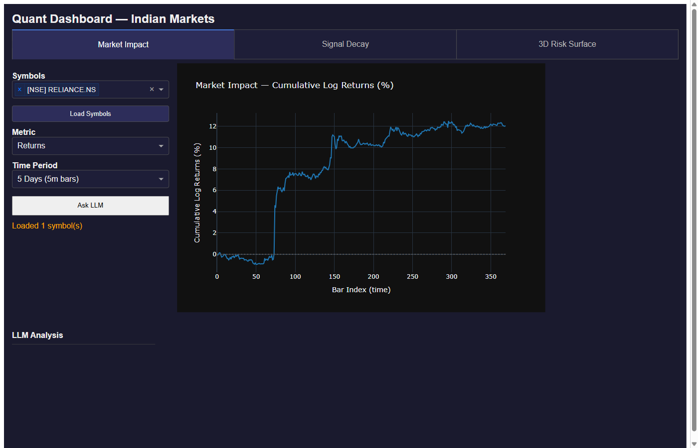
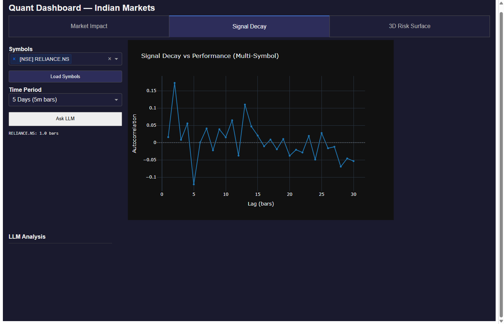
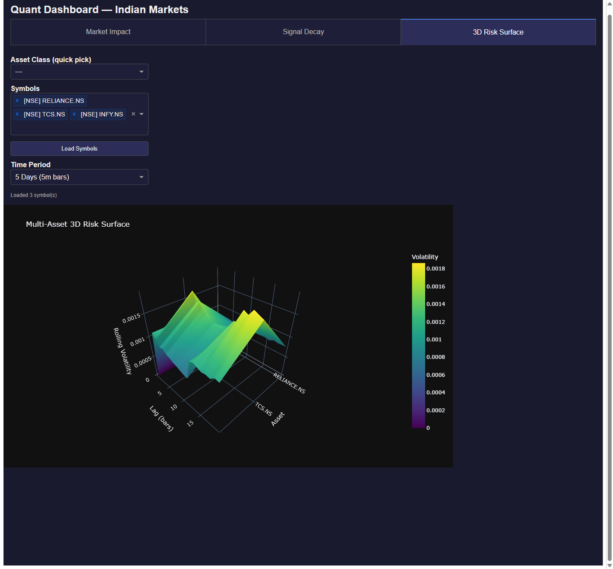
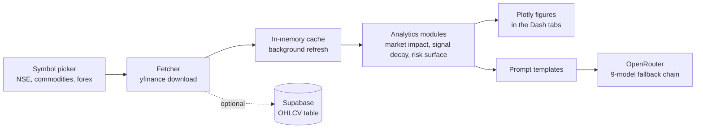

# Quant Systems: market impact, signal decay and 3D risk surface dashboard for Indian markets (Dash, Plotly, yfinance)

[](LICENSE)


-3FCF8E?logo=supabase&logoColor=white)


**Quant Systems is an open-source Python dashboard for quantitative analysis of Indian equities, commodities and forex.** Pick one or more symbols, and it pulls live market data from yfinance and draws three views: **market impact** (cumulative log-returns, rolling volatility, relative volume and activity), **signal decay** (autocorrelation curves with a computed half-life) and a **3D risk surface** (rolling volatility across symbols and time). Each tab also has an **Ask LLM** button that sends the chart context to OpenRouter for a plain-language read-out.

It is built for students, retail quants and developers who want a small, readable example of a market-analytics app in Dash and Plotly. It is an analytics and learning tool, **not investment advice** and not a trading system.



---

## Contents

- [What it does](#what-it-does)
- [Screenshots](#screenshots)
- [Proof that it runs](#proof-that-it-runs)
- [How it works](#how-it-works)
- [Quick start](#quick-start)
- [Configuration](#configuration)
- [Supported symbols](#supported-symbols)
- [Project layout](#project-layout)
- [Tests](#tests)
- [Honest status](#honest-status)
- [FAQ](#faq)
- [License](#license)

---

## What it does

| Tab | What it shows |
| --- | --- |
| **Market Impact** | Cumulative log-returns (%), rolling volatility (20-bar standard deviation), relative volume (multiple of the mean) and rolling activity (20-bar mean absolute return) for one or many symbols |
| **Signal Decay** | Autocorrelation of returns for lags 1 to 30, with a half-life per symbol (the first lag where correlation falls below half of its peak) |
| **3D Risk Surface** | A 3D surface of rolling volatility across several symbols and time, for comparing risk between assets |

- **Multi-symbol selection** with a searchable dropdown of NSE stocks, commodity futures and INR forex pairs, plus a **Load Symbols** button that triggers the charts.
- **Time periods** from 5 days of 5-minute bars up to 1 year of daily bars.
- **Ask LLM** on every tab. It tries a nine-model free-tier fallback chain on OpenRouter, so one rate-limited model does not break the feature.
- **In-memory cache** with background refresh and anomaly detection for the default watchlist.
- **Optional persistence** of OHLCV data to a Supabase table.

## Screenshots

### Signal decay: how quickly return autocorrelation fades



### 3D risk surface: rolling volatility across RELIANCE, TCS and INFY



*Screenshots are from a real run of the app with live yfinance data. The figures depend on the market data available on the day you run it.*

---

## Proof that it runs

Everything below was run on **Python 3.11.15, Windows 11**, in a fresh virtual environment built from the pinned `requirements.txt`. `pip check` reported no broken requirements.

```text
$ python -m pytest tests/ -q
.........................................                                [100%]
41 passed in 2.30s
```

The app was then started with `python app.py`, opened at `http://127.0.0.1:8050`, and all three tabs were loaded with live data for RELIANCE.NS, TCS.NS and INFY.NS. The screenshots above come from that session. The **Ask LLM** feature was not exercised in that session, because it needs an OpenRouter API key; its request, fallback and error paths are covered by unit tests with the network mocked.

---

## How it works



- **Data:** `yfinance` downloads OHLCV bars. The interval follows the period (5-minute bars for 5 days, 60-minute for 1 month, daily for 3 months and longer).
- **Analytics:** pandas, NumPy and SciPy compute log-returns, rolling statistics, autocorrelation and the volatility surface.
- **UI:** Dash callbacks rebuild the Plotly figure when you click **Load Symbols**.
- **LLM:** prompt templates describe the chart to the model, and the client walks a fallback list when a model returns 429 or 503.

---

## Quick start

**Verified on Python 3.11 on Windows.** The pinned versions in `requirements.txt` have no prebuilt wheels for Python 3.13, so use Python 3.11 or 3.12 with the pinned file. On Python 3.13 the pins for NumPy, pandas and SciPy fail to build; loosen them to newer releases and run the tests yourself.

```bash
git clone https://github.com/maahin-1/quant-systems-market-impact-signal-risk-collection.git
cd quant-systems-market-impact-signal-risk-collection/quant-dashboard

python -m venv .venv
# Windows:  .venv\Scripts\activate      macOS/Linux:  source .venv/bin/activate
pip install -r requirements.txt

python app.py
```

Open [http://127.0.0.1:8050](http://127.0.0.1:8050). No API keys are needed to see the charts. Keys are only needed for **Ask LLM** and for Supabase persistence.

## Configuration

Copy `.env.example` to `.env` and fill in only what you need. Never commit your `.env`.

| Variable | Needed for | Description |
| --- | --- | --- |
| `OPENROUTER_API_KEY` | Ask LLM | Key from [openrouter.ai](https://openrouter.ai) |
| `SUPABASE_URL` | Persistence (optional) | Your Supabase project URL |
| `SUPABASE_KEY` | Persistence (optional) | Supabase service role key. Keep it secret. |

Optional Supabase table, run in the SQL editor:

```sql
CREATE TABLE IF NOT EXISTS ohlcv (
    symbol      TEXT NOT NULL,
    timestamp   TIMESTAMPTZ NOT NULL,
    open        DOUBLE PRECISION,
    high        DOUBLE PRECISION,
    low         DOUBLE PRECISION,
    close       DOUBLE PRECISION,
    volume      DOUBLE PRECISION,
    PRIMARY KEY (symbol, timestamp)
);
CREATE INDEX IF NOT EXISTS ohlcv_symbol_idx ON ohlcv (symbol);
```

## Supported symbols

- **NSE stocks:** RELIANCE.NS, TCS.NS, INFY.NS, HDFCBANK.NS and 60+ more.
- **Commodities:** GC=F (gold), CL=F (crude oil), SI=F (silver) and more.
- **Forex:** USDINR=X, EURINR=X, GBPINR=X and more.

Any other yfinance ticker can be added in `quant-dashboard/config.py`.

## Project layout

```text
quant-dashboard/
  app.py                  Dash app, tab routing
  config.py               Symbol lists and environment variables
  requirements.txt        Pinned dependencies
  .env.example            Template for local secrets
  assets/custom.css       Dark theme for dropdowns and tabs
  data/
    fetcher.py            yfinance download, MultiIndex flattening
    cache.py              In-memory cache, background refresh, anomaly checks
    supabase_client.py    Optional OHLCV persistence
  llm/
    client.py             OpenRouter client with 9-model fallback
    prompts.py            Prompt templates per tab
  modules/
    market_impact.py      Market Impact tab
    signal_decay.py       Signal Decay tab
    risk_surface.py       3D Risk Surface tab
  tests/                  41 offline unit tests
docs/images/              Screenshots used in this README
```

## Tests

```bash
cd quant-dashboard
pip install -r requirements.txt
python -m pytest tests/ -q
```

The suite is offline: yfinance and OpenRouter calls are mocked, so it needs no network or keys.

---

## Honest status

- **Learning and research tool.** It makes no trading recommendations, and its numbers are not validated for real trading.
- **Free data.** yfinance is an unofficial source. It can lag, return gaps or change without notice, and intraday history is limited to recent days.
- **Free-tier LLMs.** The commentary comes from free OpenRouter models, which can be slow, rate-limited or wrong. Treat it as a draft explanation, not analysis.
- **Verified on one setup:** Python 3.11 on Windows. Other platforms and Python versions are untested.

---

## FAQ

### What is Quant Systems?
A Dash and Plotly dashboard that analyses market impact, signal decay and risk for NSE stocks, commodities and INR forex pairs, with optional LLM commentary on each chart.

### Which markets and symbols does it cover?
NSE stocks such as RELIANCE.NS, TCS.NS, INFY.NS and HDFCBANK.NS (60+ in total), commodity futures such as GC=F, CL=F and SI=F, and forex pairs such as USDINR=X, EURINR=X and GBPINR=X.

### Where does the data come from?
yfinance. Downloads are cached in memory with a background refresh, and can optionally be saved to a Supabase OHLCV table.

### Do I need API keys?
No, not to see the charts. You need an OpenRouter key for the Ask LLM button, and Supabase credentials only if you want persistence. See `.env.example`.

### What does signal decay measure?
How quickly the autocorrelation of returns falls off as the lag grows. The dashboard reports a half-life: the first lag where correlation drops below half of its peak.

### What does the 3D risk surface show?
Rolling volatility across several symbols and time, drawn as a surface so you can compare risk between assets at a glance.

### Which Python version should I use?
Python 3.11 (verified) or 3.12. The pinned NumPy, pandas and SciPy versions do not install on Python 3.13 without loosening the pins.

### Is this investment advice?
No. It is a research and learning dashboard and makes no trading recommendations.

### Is it free to use?
Yes. It is MIT licensed. Market data and LLM access come from third-party services with their own terms.

---

## License

Licensed under the [MIT License](LICENSE). Copyright (c) 2026 Maahin Bir Singh Osahan.

*Keywords: quantitative finance dashboard, Indian stock market, NSE, market impact, signal decay, autocorrelation half-life, 3D risk surface, volatility surface, Dash, Plotly, yfinance, Supabase, OpenRouter, LLM market commentary, Python, open source.*
